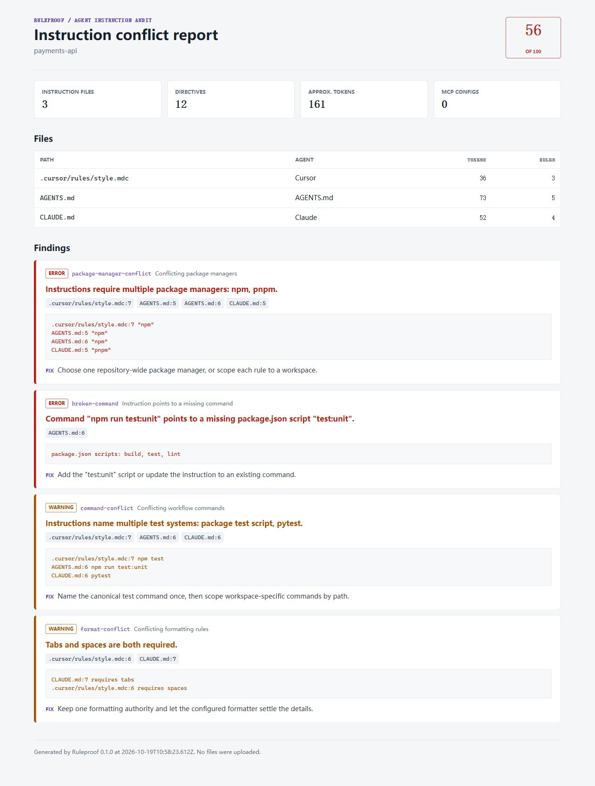

# Ruleproof

**Your coding agents read four rule files. They cannot agree.**

[](https://github.com/stilburn007/ruleproof/actions/workflows/ci.yml)
[](https://github.com/stilburn007/ruleproof)
[](https://nodejs.org/)
[](LICENSE)



[Open the live demo report](https://stilburn007.github.io/ruleproof/)

Ruleproof is a zero-dependency CLI that audits the instructions agents actually
follow. It finds contradictory rules, commands that no longer exist, stale
paths, duplicated context, leaked credentials, prompt-injection patterns, and
unsafe shell behavior across:

- `AGENTS.md` and nested `AGENTS.md`
- `CLAUDE.md`
- `GEMINI.md`
- Cursor rules (`.cursor/rules/*.mdc`)
- `.cursorrules`, `.windsurfrules`, and `.clinerules`
- GitHub Copilot instruction files

No account, API key, or network request is required.

```text
RULEPROOF  FAIL  payments-api  score 54/100
3 instruction files | 41 directives | ~1,842 tokens

FINDINGS
  ERROR   package-manager-conflict  Instructions require multiple package managers: npm, pnpm.
        AGENTS.md:11, CLAUDE.md:7
        fix Choose one repository-wide package manager, or scope each rule to a workspace.

  ERROR   broken-command  Command "npm run test:unit" points to a missing package.json script "test:unit".
        AGENTS.md:18
        fix Add the "test:unit" script or update the instruction to an existing command.

  ERROR   file-scope-conflict  "dist/client.js" is both required and forbidden.
        AGENTS.md:24, .cursor/rules/release.mdc:9
        fix Narrow each rule to a distinct path or remove one of the conflicting requirements.

  WARNING format-conflict  Tabs and spaces are both required.
        CLAUDE.md:14, .cursor/rules/style.mdc:6
        fix Keep one formatting authority and let the configured formatter settle the details.

RESULT  3 errors, 4 warnings, 0 info  |  score 54/100
```

## Quick start

Run it from any repository:

```bash
npx --yes github:stilburn007/ruleproof .
```

Useful modes:

```bash
# Include evidence after each finding
npx --yes github:stilburn007/ruleproof . --verbose

# Fail CI on warnings too
npx --yes github:stilburn007/ruleproof . --strict

# Produce a standalone report with no external assets
npx --yes github:stilburn007/ruleproof . --format html --output ruleproof-report.html

# Emit SARIF for a code scanning integration
npx --yes github:stilburn007/ruleproof . --format sarif --output ruleproof.sarif

# Generate a README score badge
npx --yes github:stilburn007/ruleproof . --format badge --output .github/ruleproof.svg
```

Exit codes are CI-friendly: `0` means the configured threshold passed, `1`
means findings crossed it, and `2` means the scan could not run.

Try the intentionally broken example in this repository:

```bash
git clone https://github.com/stilburn007/ruleproof.git
cd ruleproof
node bin/ruleproof.js examples/payments-api --verbose
```

## Why this exists

A repository used to have one contributing guide, mostly read by people. A
modern repository can now contain a dozen overlapping instruction surfaces,
each consumed by a different coding agent, editor, or automation tool.

Those files drift independently:

- `AGENTS.md` says pnpm, `CLAUDE.md` says npm.
- One rule requires generated files to be committed, another forbids editing
  them.
- A test command survives after its package script is removed.
- The same 300-token instruction is pasted into four files.
- A helpful-looking rule tells an agent not to surface an error to the user.

Treating those files as source code means linting them like source code.

## What Ruleproof checks

| Area | Examples |
| --- | --- |
| Cross-file conflicts | Different package managers, test runners, commit policies, indentation, or path ownership |
| Repository drift | Missing package script, Make target, just recipe, script file, or referenced path |
| Context cost | Approximate token budget and repeated directives across files |
| Credentials | AWS, GitHub, OpenAI, Slack, Google, JWT, and private-key patterns |
| Agent safety | Prompt overrides, hidden actions, approval bypasses, remote script execution, destructive commands |
| Portability | Machine-specific absolute paths that only work on one computer |

Ruleproof does not execute commands from instruction files. It reads repository
metadata such as `package.json`, `Makefile`, `justfile`, and lockfiles to verify
what the instructions claim.

## GitHub Action

```yaml
name: Ruleproof

on:
  pull_request:
  push:
    branches: [main]

permissions:
  contents: read

jobs:
  audit:
    runs-on: ubuntu-latest
    steps:
      - uses: actions/checkout@v4
      - uses: stilburn007/ruleproof@v1
        with:
          fail-on: error
```

The action adds GitHub annotations and a job summary. Pin the action to a
release tag rather than a moving branch.

## Configuration

Create `.ruleproof.json` with `ruleproof init` or by hand:

```json
{
  "ignore": ["vendor/**", "examples/**"],
  "budget": {
    "warning": 2500,
    "error": 5000
  },
  "failOn": "error",
  "minScore": 80,
  "rules": {
    "duplicate-instruction": "info",
    "absolute-path": "warning"
  },
  "allow": [
    {
      "rule": "absolute-path",
      "path": "docs/local-setup.md"
    }
  ]
}
```

Set a rule to `off`, `info`, `warning`, or `error`. Use `allow` for narrow,
explainable exceptions rather than disabling a rule for the whole repository.

List every rule:

```bash
node bin/ruleproof.js --list-rules
```

## Output formats

| Format | Use |
| --- | --- |
| `pretty` | Local terminal output |
| `json` | Custom automation and dashboards |
| `markdown` | Pull request comments and job summaries |
| `github` | GitHub Actions annotations |
| `sarif` | GitHub code scanning and SARIF-compatible tools |
| `html` | Self-contained report for review or sharing |
| `badge` | SVG score badge for a README |

## Design principles

- **Deterministic first.** Core checks do not call an LLM.
- **Local by default.** Repository content never leaves the machine.
- **Actionable findings.** Every issue identifies a file, line, and concrete
  fix where possible.
- **Zero runtime dependencies.** One package, one CLI, no supply-chain ladder.
- **Conservative claims.** Ruleproof verifies file and command existence; it
  does not pretend to understand every sentence in natural language.

## Current limitations

- Conflict detection is strongest for explicit, short directives.
- Monorepo rules scoped to different packages may need an `allow` entry until
  path-aware scoping lands.
- Commands are validated against repository metadata, not executed.
- HTML reports can contain repository instructions, so treat them as source
  material when they come from a private repository.

See [ROADMAP.md](ROADMAP.md) for the next set of changes.

## Contributing

Issues with a minimal conflicting instruction pair are especially useful.
Read [CONTRIBUTING.md](CONTRIBUTING.md) before opening a pull request.

If Ruleproof catches a real conflict in your repository, star the project so
more agents start with instructions that tell the truth.

## License

MIT
